# 맞춤형 농작물 재배 일정 공급 서비스 **FarmPlan** 개발 지침서

> [!IMPORTANT]
> 본 문서는 **등록특허 제10-2814596호**(*재배 환경 변화에 따라 일정 업데이트가 가능한 노지작물의 재배일정 제공 시스템 및 방법*)와 **한팜(HanFarm) 생육예측 및 재배관리 시스템 설계도(도 1~도 4)**를 통합 분석하여 작성된 플랫폼 개발 표준 지침서입니다.
> 모든 작물 마스터 및 일정 엔진은 **1단계 작물군 → 2단계 작물(품종 연계) → 3단계 재배작형**의 3단계 표준 계층 구조를 기반으로 설계·구현되어야 합니다.

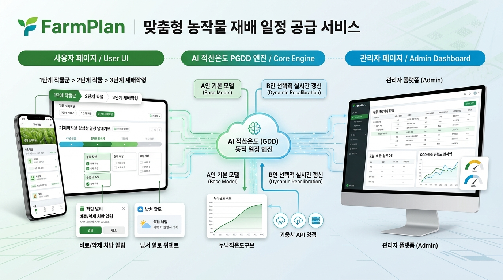

---

## 1. 프로젝트 개요 및 핵심 가치

### 1.1 프로젝트 명칭
- **국문**: 맞춤형 농작물 재배 일정 공급 서비스 **FarmPlan** (팜플랜)
- **영문**: **FarmPlan** — Adaptive Crop Cultivation Scheduling & Growth Prediction Platform

### 1.2 배경 및 목적
기존 스마트팜 기술은 시설원예·식물공장에 편중되어 있어 자연 환경(기후, 토양)의 영향을 직접 받는 노지 및 일반 재배 농가는 경험과 주관적 판단에 의존해 파종·정식·시비·방제·수확 일정을 계획해 왔습니다.

**FarmPlan**은 다음 두 가지 핵심 특허 기술을 결합하여 데이터 기반의 정밀 농업 플랫폼을 구현합니다:
1. **기후·토양·작물 특성 기반 전 주기 재배일정 자동 수립 및 동적 재조정 (등록특허 10-2814596)**:
   - 재배 토양 만들기(경운·멀칭)부터 파종/정식, 비료 시비, 작물보호제(농약) 처방, 수확까지 **주요재배일정**과 **세부재배일정**을 자동 산출합니다.
   - 기상 변화(이상기후·급격한 기온 변화) 및 농가의 실제 작업 이행 여부에 따라 **과거 실제 기온 + 미래 예측 기온**을 결합하여 잔여 필요적산온도 기반으로 일정을 실시간 재조정합니다.
2. **실행 확인 기반 재배이력 자동 수집 및 생육예측모델(GDD/PGDD) 순환 학습·갱신 (첨부 설계도 1~4)**:
   - 별도의 복잡한 영농일지 입력 없이, 사용자가 재배일정 UI에서 **‘농작업 완료’** 및 **‘생육단계 도달’**을 체크(실제 날짜 확인)하면 자동으로 구조화된 재배이력 DB가 생성됩니다.
   - 기상청 Open API를 통해 실제 도달 기간의 일별 기온을 매칭하고 **생육단계별 적산온도(PGDD)**를 역산하여 **A안(기본 적산온도 및 환경 보정 모델 생성)** 및 **B안(예측오차 분석 및 선택적 모델 갱신)**의 순환형 고도화를 수행합니다.

---

## 2. 시스템 통합 아키텍처 및 데이터 순환 구조

### 2.1 시스템 도면 슬라이드 (설계도 1 ~ 4)

````carousel
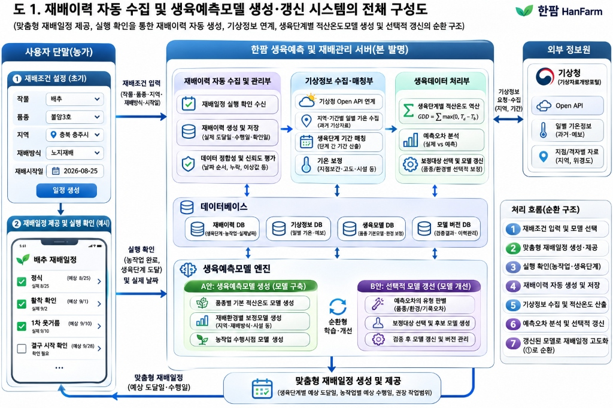
<!-- slide -->
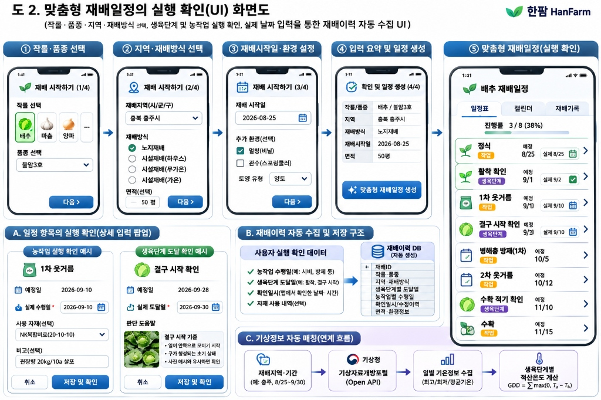
<!-- slide -->
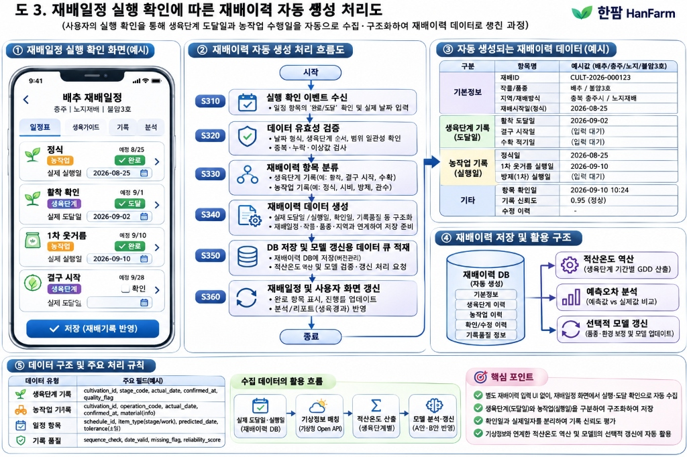
<!-- slide -->
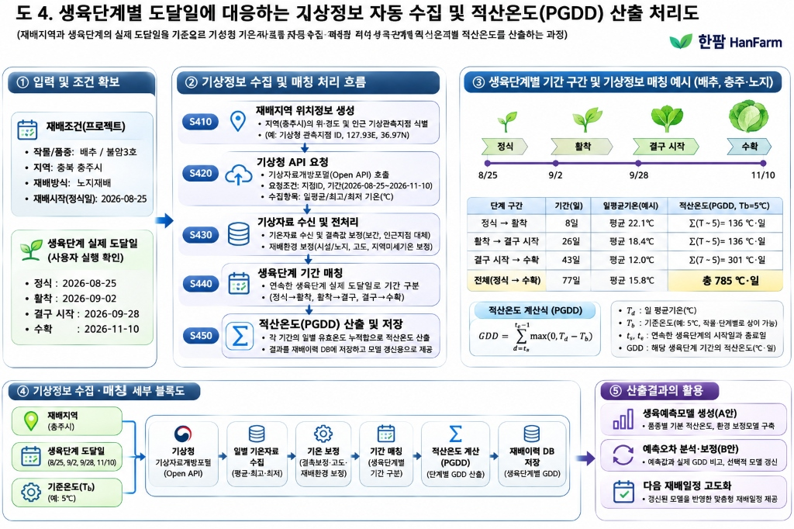
````

### 2.2 전체 모듈 구성 및 데이터 흐름도

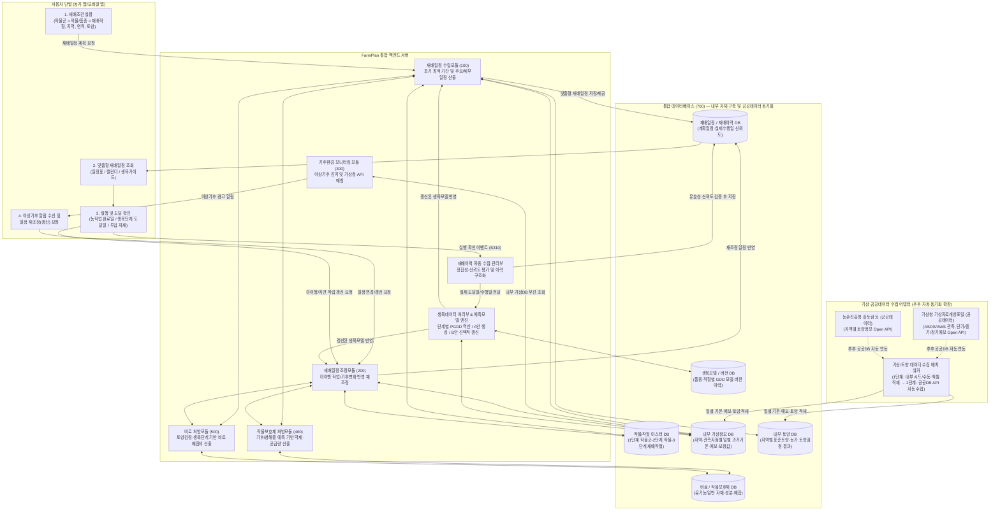

---

## 3. 농작물 3단계 표준 관리 기준 (Crop Taxonomy Architecture)

사용자의 요구사항과 특허명세서(감자 조생종/중생종/만생종, 봄재배/가을재배, 노지/시설 구분 등)를 결합하여, FarmPlan의 모든 농작물 데이터는 **1단계 작물군 → 2단계 작물(및 품종) → 3단계 재배작형**의 3단계 계층 구조로 관리합니다.

### 3.1 3단계 계층 구조 다이어그램

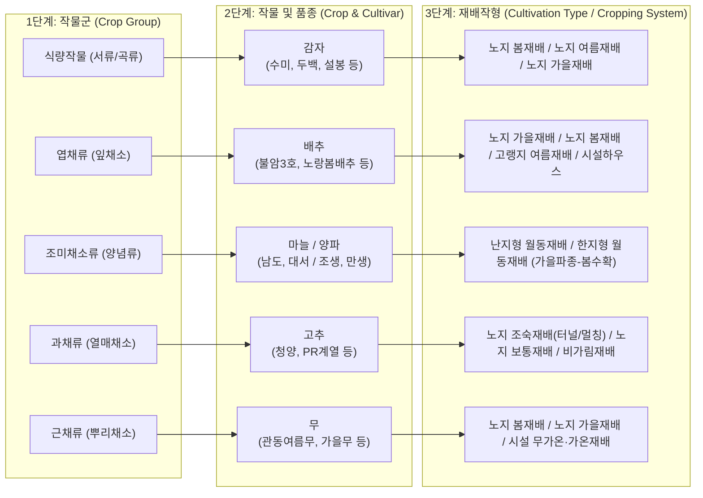

### 3.2 3단계 농작물 분류 및 생육 파라미터 표준 설계표

> [!NOTE]
> 동일 작물이라도 **3단계 재배작형(재배시기·방식)**과 **품종(조생/중생/만생)**에 따라 기준온도($T_b$), 필요적산온도(GDD), 생육장해온도(저온/고온), 그리고 주요 농작업 구성(파종 vs 정식, 월동 유무)이 달라지므로, **생육예측모델(GDD 모델)의 기본 키(Primary Key)는 `[작물군 ID + 작물/품종 ID + 재배작형 ID]` 조합**으로 설계합니다.

| 1단계: 작물군 (`crop_group`) | 2단계: 작물 (`crop`) | 대표 품종 (`cultivar` / 숙기) | 3단계: 재배작형 (`cropping_system`) | 재배방식 및 환경 특성 | 기준온도 ($T_b$) | 필요(유효)적산온도 및 생육온도 기준 | 주요 생육단계 및 농작업 템플릿 |
| :--- | :--- | :--- | :--- | :--- | :---: | :--- | :--- |
| **식량작물 (서류)** | **감자** | 수미 (중생종, 95~110일)<br/>조생종 (80~95일)<br/>만생종 (110일+) | **노지 봄재배**<br/>노지 가을재배<br/>고랭지 여름재배<br/>시설 조기재배 | 노지 / 멀칭 선택<br/>봄재배(2~3월~7월) | $5^\circ\text{C}$<br/>(적산 $0^\circ\text{C}$) | • 필요유효적산: $1,000^\circ\text{C}\cdot\text{일}$ (적산 $1,300^\circ\text{C}$)<br/>• 생육적온: $14\sim 23^\circ\text{C}$<br/>• 한계온도: $5\sim 25^\circ\text{C}$<br/>• 장해온도: 저온 $\le 5^\circ\text{C}$(서리 $3^\circ\text{C}$, 동해 $0^\circ\text{C}$), 고온 $\ge 30^\circ\text{C}$ | 토양개량 $\rightarrow$ 퇴비시비 $\rightarrow$ 경운·멀칭 $\rightarrow$ 파종(정식) $\rightarrow$ 출아/활착 $\rightarrow$ 잡초관리(1·2차) $\rightarrow$ 괴경비대기(추비/배수/방제) $\rightarrow$ 수확 |
| **엽채류** | **배추** | 불암3호 (가을배추)<br/>춘광 (봄배추)<br/>고랭지 여름배추 | **노지 가을재배**<br/>노지 봄재배<br/>시설(하우스/무가온/가온)<br/>고랭지 재배 | 노지 / 비닐멀칭 / 관수(스프링클러) | $5^\circ\text{C}$ | • 필요유효적산: 약 $785\sim 900^\circ\text{C}\cdot\text{일}$<br/>• 단계별 예시: 정식$\rightarrow$활착($136^\circ\text{C}\cdot\text{일}$), 활착$\rightarrow$결구시작($136^\circ\text{C}\cdot\text{일}$), 결구$\rightarrow$수확($301^\circ\text{C}\cdot\text{일}$)<br/>• 생육적온: $15\sim 20^\circ\text{C}$ (결구기 $15\sim 18^\circ\text{C}$) | 밑거름·이랑만들기 $\rightarrow$ 정식 $\rightarrow$ **활착 확인** $\rightarrow$ 1차 웃거름 $\rightarrow$ **결구 시작 확인** $\rightarrow$ 병해충 방제(1·2차) $\rightarrow$ 2차 웃거름 $\rightarrow$ **수확 적기 확인** $\rightarrow$ 수확 |
| **조미채소류** | **마늘** | 남도마늘 (난지형)<br/>대서마늘 (난지형)<br/>의성마늘 (한지형) | **난지형 노지 월동재배**<br/>한지형 노지 월동재배 | 가을 파종 $\rightarrow$ 겨울 월동 $\rightarrow$ 봄 수확 (저온장해 예외/조절 적용) | $5^\circ\text{C}$ | • 월동작물 특성상 동절기 최저한계온도 이하 구간을 휴면/월동기로 허용하되 극한 동해 기준 별도 관리<br/>• 인편분화 및 구비대기 적온 관리 | 토양개량·밑거름 $\rightarrow$ 파종 $\rightarrow$ 멀칭 $\rightarrow$ 발아/월동전 관리 $\rightarrow$ 월동기(배수/피복) $\rightarrow$ 생육재생기(웃거름 1·2차) $\rightarrow$ 마늘종 제거 $\rightarrow$ 구비대기 방제 $\rightarrow$ 수확 |
| **조미채소류** | **양파** | 조생종 / 중만생종 | **노지 월동재배**<br/>노지 봄파종재배 | 가을 정식 $\rightarrow$ 겨울 월동 $\rightarrow$ 봄/초여름 수확 | $5^\circ\text{C}$ | • 월동 기간 저온장해 예외 파라미터 적용<br/>• 구비대기 고온장해 및 일장 조건 연동 | 육묘/본밭준비 $\rightarrow$ 정식 $\rightarrow$ 활착확인 $\rightarrow$ 월동관리 $\rightarrow$ 생육재생기 추비 $\rightarrow$ 구비대기 관수·방제 $\rightarrow$ 도복확인 $\rightarrow$ 수확 |
| **근채류** | **무** | 가을김장무<br/>봄무 / 여름무 | **노지 가을재배**<br/>노지 봄재배<br/>시설재배 | 직파 재배 위주, 토심·배수 관리 중요 | $8^\circ\text{C}$ | • 최저한계온도: $8^\circ\text{C}$ (특허 명세 기준)<br/>• 생육적온: $17\sim 20^\circ\text{C}$ | 토양개량·깊이갈이 $\rightarrow$ 파종 $\rightarrow$ 발아·솎음작업 $\rightarrow$ 1·2차 웃거름 $\rightarrow$ 뿌리비대기 관수·방제 $\rightarrow$ 수확 |
| **식량작물 (곡류)** | **메밀 / 벼** | 일반메밀 / 벼 품종 | **노지 여름·가을재배**<br/>**벼 보통기 논재배** | 단기 생육(메밀) vs 장기 생육(벼) | $0^\circ\text{C}$ / $10^\circ\text{C}$ | • 메밀 필요적산온도: $1,000\sim 1,200^\circ\text{C}$ (최저군)<br/>• 벼 필요적산온도: $3,500\sim 4,500^\circ\text{C}$ (최고군) | 작형별 표준 경종일정 및 물관리·시비·방제 템플릿 적용 |

---

## 4. 핵심 알고리즘 및 비즈니스 로직 명세

백엔드 엔진과 프론트엔드 UI가 상호작용하는 핵심 알고리즘 5가지를 정의합니다.

### 4.1 초기 재배기간 및 주요재배일정 산출 알고리즘 (특허 청구항 2~3, 도 5~6)
1. **파라미터 로드 (`S141`)**: 선택된 `[작물군 - 작물/품종 - 재배작형]`의 필요적산온도(또는 필요유효적산온도), 생육최적온도 범위, 생육한계온도(최고/최저), 생육장해온도(고온/저온)를 조회합니다.
2. **기후 데이터 수집 (`S141`)**: 재배지 주소(시/군/구 및 위경도)에 대응하는 과거 1년 기온 데이터 및 기상청 예측기후정보(단기·중기·1개월·3개월·연간 전망)를 수집합니다.
3. **적산온도 매칭 후보 기간 산출 (`S142`)**:
   - **일반 적산온도 적용 시**: 일평균기온 $T_d \ge 0^\circ\text{C}$인 날의 합산이 필요적산온도에 도달하는 모든 후보 시작~종료 구간 산출.
   - **유효적산온도(PGDD) 적용 시**: 기준온도(최저한계온도 $T_b$, 예: 감자·배추 $5^\circ\text{C}$, 무 $8^\circ\text{C}$) 이상인 날에 대해 다음 수식으로 구간 적산온도를 계산합니다:
     $$GDD = \sum_{d=t_s}^{t_e - 1} \max(0, T_d - T_b)$$
4. **생육장해온도 구간 필터링 (`S143`)**: 후보 구간 중 저온장해온도 이하(예: 감자 $\le 5^\circ\text{C}$) 또는 고온장해온도 이상(예: 감자 $\ge 27\sim 30^\circ\text{C}$)이 지속되어 피해가 예상되는 기간을 제외합니다.
   - *예외 규칙*: **3단계 재배작형**이 `월동재배`(마늘, 양파 등 가을 파종~봄 수확)인 경우 동절기 저온한계온도 제외 필터를 완화/조절하여 적용합니다.
5. **생육최적온도 최다 포함 기간 선정 (`S144`)**: 남은 후보 기간 중 작물의 생육최적온도(예: 감자 $14\sim 23^\circ\text{C}$)에 해당하는 일수가 가장 많은 기간(복수 가능, 예: 봄재배 3~6월, 가을재배 6~9월)을 최적 재배기간으로 선정하고 주요 농작업(토양만들기, 파종/정식, 수확)을 배정합니다.

### 4.2 토양 검정 연동 비료 처방 및 배합비 산출 로직 (특허 청구항 4~5, 도 3, 도 7)
1. **토양 영양분 검출**: 재배지 주소 기반 지역별 토양DB 조회 또는 사용자가 직접 입력한 **토양검정 자료**(`산도 pH`, `유기물 함량(g/kg)`, `유효인산(mg/kg)`, `칼륨(cmol+/kg)`, `칼슘(cmol+/kg)`, `마그네슘(cmol+/kg)`, `유효규산`, `전기전도도(EC)`)를 적정 범위 기준치와 비교합니다.
   - *특허 명세서 기준치 예시*: pH `6.0~6.5`, 유기물 `25~35`, 유효인산 `300~400`, 칼륨 `0.4~0.8`, 칼슘 `4.0~7.0`, 마그네슘 `1.0~2.0`, 전기전도도 `0.0~2.0`.
2. **부족 성분 및 처방 산출**:
   - 예: 검정 결과 pH가 `7.4`(기준 초과)이고 칼륨이 `0.11`(기준 미달)인 경우 $\rightarrow$ 산도를 낮추기 위한 유기물 비료(가축분 퇴비 등) 시비량 증량 + 칼륨 보충 비료 산출.
   - **복합 배합 알고리즘**: 부족한 영양 성분이 다수인데 단일 비료로 매칭되지 않는 경우, 비료DB에서 복수의 비료를 조합하여 **비료 종류, 배합비, 경작면적(평/10a) 대비 총 시비량(kg) 및 농자재 구매 수량/예상 비용**을 자동 산출하여 세부재배일정(밑거름, 1·2차 웃거름)에 추가합니다.

### 4.3 예측기후 기반 작물보호제(농약) 및 농작업 처방 로직 (특허 청구항 6, 13)
- 재배기간 중 예측기후(고온다습, 장마, 가뭄, 일조 부족 등)와 생육단계를 매칭하여 예상되는 병해충 및 생리장해를 예측합니다.
- 친환경 재배 여부(유기농자재 vs 일반농자재) 및 경작 면적을 반영하여 **작물보호제(살충제, 살균제, 제초제) 및 작물영양제 종류, 처방 시기, 희석/공급량(ml/L), 구매 수량**과 함께 **특정 농작업(배수로 정비, 잡초 관리 등)**을 세부재배일정으로 배치합니다.

### 4.4 실행 확인에 따른 재배이력 자동 생성 및 동적 일정 재조정 (특허 청구항 8~13, 도 2~3)
1. **실행 확인 데이터 수집 (`S310~S340`)**:
   - 사용자가 일정 화면에서 **농작업 완료**(예: 정식, 1차 웃거름) 또는 **생육단계 도달**(예: 활착 확인, 결구 시작 확인)의 실제 날짜(`actual_date`)를 입력하면, 시스템은 확인 일시(`confirmed_at`)와 분리하여 기록하고 **데이터 유효성 및 신뢰도 점수(`reliability_score`, 0.0~1.0)**를 산출합니다.
2. **사용자 작업 지연/변경에 따른 재조정**:
   - 예정된 주요 작업을 기한 내 이행하지 못해 실제 시행일로 수정 후 갱신 요청 시, **이미 완료된 주요 작업은 고정(제외)**하고 미이행 작업들을 현 시점 기준으로 재산출합니다.
3. **기후변화 모니터링 알림 및 하이브리드 기온 재조정 (`S210~S230`)**:
   - 이상기후 발생 또는 예측기후 변동으로 피해가 예상되면 사용자에게 **일정 변경 요청 알림**을 발송합니다.
   - 재조정 시 **[파종/정식일 ~ 현재 시점]까지는 실제 관측 기온**으로 업데이트하여 기 누적된 실제 적산온도($GDD_{\text{actual}}$)를 계산하고, 전체 필요적산온도에서 차감한 **잔여 필요적산온도($GDD_{\text{rem}} = GDD_{\text{total}} - GDD_{\text{actual}}$)**를 산출합니다.
   - **[현재 시점 이후]는 새로 업데이트된 예측기후정보**를 적용하여 $GDD_{\text{rem}}$이 충족되는 새로운 수확일 및 잔여 주요/세부일정(시비·방제 시기 및 공급량)을 재조정합니다.

### 4.5 생육예측모델 생성(A안) 및 선택적 모델 갱신(B안) 순환 로직 (특허 청구항 14, 도 1, 도 4)
- **기상 보정 및 구간 PGDD 역산 (`S410~S450`)**: 재배이력의 연속된 생육단계 도달일(예: 정식 8/25 $\rightarrow$ 활착 9/2 $\rightarrow$ 결구 9/28 $\rightarrow$ 수확 11/10) 구간별로 기상청 관측 기온을 수집하고, 결측치 보간 및 재배환경 보정(고도, 노지/시설, 지역 미세기온)을 거쳐 구간별 실제 PGDD를 산출합니다.
- **A안 (생육예측모델 신규 구축)**: 축적된 이력을 바탕으로 품종별 기본 적산온도 모델, 재배환경별(지역·작형·시설) 보정모델, 농작업 수행시점 모델을 생성합니다.
- **B안 (선택적 모델 갱신)**: 예측 도달일(또는 예측 GDD)과 실제 도달일(실제 GDD) 간의 **예측오차 유형(품종 오차 / 환경 오차 / 사용자 기록 오차)**을 판별합니다. 기록 신뢰도가 기준치 이상인 유효 데이터에 한해 보정대상을 선택하고 후보 모델을 생성·검증한 뒤 **모델 버전 DB**를 업데이트하여 다음 재배일정 수립 시 정확도를 높입니다.

---

## 5. 사용자 페이지 (User Page) 및 마이페이지 개발 지침

사용자 서비스는 크게 **① 사용자 페이지 메인 카테고리(작물재배 일정 요청 · 작물재배 일정 요청 현황 · 일정 산출/재조정 처리 현황 및 소식 · 3단계 작물/작형 가이드)**와 **② 마이페이지(나의 작물 재배 일정 관리 · 농작업/생육단계 실행 확인 · 맞춤형 비료/농약 처방서 · 일정 재조정 · 자동 재배이력)**의 이원화 구조로 설계합니다.

> [!IMPORTANT]
> **사용자 페이지 vs 마이페이지 역할 분리 원칙**
> - **사용자 페이지 메인 카테고리 (Public / Service Portal)**:
>   1. **작물재배 일정 요청하기**: 4단계 위저드를 통한 신규 맞춤형 재배일정 계획 요청(`S110`)
>   2. **작물재배 일정 요청 현황**: 전국 농가에서 접수된 **3단계 농작물(작물군 > 작물/품종 > 재배작형)별·지역별·시기별 일정 요청 현황 데이터**, 실시간 접수 목록, 요청 상세 조건(면적·토양검정 유무·친환경/조기재배 여부) 및 작형별 요청 통계 대시보드
>   3. **일정 산출 · 재조정 처리 현황 & 기상 소식**: 접수된 요청 건들의 실시간 서버 처리 파이프라인 현황(`S120~S150` 수립 처리 및 `S210~S230` 이상기후/미이행 재조정 처리 현황)과 지역별 이상기후 일정변경 권고 소식 브리핑
>   4. **3단계 작물 · 작형 표준 가이드**: 작물군·작물/품종·재배작형별 기준온도($T_b$), 필요적산온도(PGDD), 생육적온 및 표준 재배력 안내
> - **마이페이지 (My Page — 개인화 영농 워크스페이스)**:
>   - 로그인한 농가의 **나의 작물 재배 일정 요청 내역 및 진행 상태**, **나의 맞춤형 재배일정 조회(일정표/캘린더)**, **농작업 완료 및 생육단계 도달 실행 확인**, **내 농장 비료·작물보호제 처방 및 자재 구매 견적**, **미이행/이상기후 일정 재조정(갱신) 관리**, **생육단계별 적산온도(PGDD) 분석 및 자동 생성 재배이력(영농일지)**을 전담합니다.

### 5.1 사용자 페이지 & 마이페이지 전체 메뉴 구조 (1Depth ~ 3Depth)

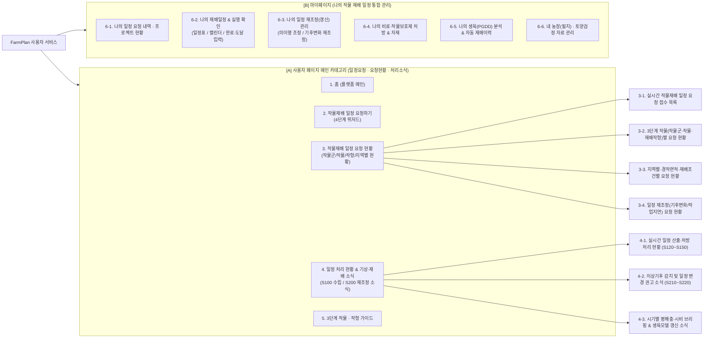

| 구분 | 1Depth (카테고리) | 2Depth (서브 메뉴) | 3Depth (세부 기능 및 표시 항목) | 특허 및 설계도 근거 |
| :---: | :--- | :--- | :--- | :--- |
| **사용자 메인 카테고리**<br/>*(일정요청 · 요청현황 · 처리소식)* | **1. 홈 (플랫폼 메인)** | **1-1. 종합 요청·처리 요약 배너** | • 금일 누적 **작물재배 일정 요청 건수**, 산출 완료 건수, 기후변화 재조정 건수 실시간 요약 카운터<br/>• 빠른 일정 요청 CTA 버튼 및 마이페이지(내 재배일정 진행률) 미니 요약 위젯 | 특허 도 4(`S100, S200`),<br/>설계도 도 1 |
| | | **1-2. 실시간 요청 현황 & 기상특보 브리핑** | • 최근 접수된 작물재배 일정 요청 티커(예: `[충북 충주] 배추(불암3호) · 노지가을재배 · 50평 요청 접수`)<br/>• 전국 주산지 이상기후(한파·폭염·호우) 발령 및 주요 농작업 소식 하이라이트 | 특허 청구항 1(`S110, S220`) |
| | **2. 작물재배 일정 요청하기** | **2-1. [Step 1/4] 3단계 작물 선택** | • `1단계 작물군` $\rightarrow$ `2단계 작물/품종` $\rightarrow$ `3단계 재배작형` 선택 (조기/친환경 여부 포함) | 사용자 3단계 기준,<br/>도 2(①, ②) |
| | | **2-2. [Step 2/4] 지역·면적 설정** | • 재배지 주소(시/군/구·상세주소) 및 경작 면적(평/10a) 입력 | 도 2(②), 특허 도 7 |
| | | **2-3. [Step 3/4] 시작일·환경·토양** | • 희망 시작일(또는 AI 최적 시기 추천), 멀칭/관수 옵션, 토양검정 8대 항목 입력 | 도 2(③), 특허 도 7 |
| | | **2-4. [Step 4/4] 요약 및 일정 요청** | • 입력 조건 최종 확인 후 **`[✨ 맞춤형 재배일정 요청]`** 제출 (`S110` 이벤트 발생 $\rightarrow$ **3번 ‘작물재배 일정 요청 현황’**에 등록 및 **마이페이지** 연동) | 특허 `S110~S150`,<br/>도 2(④) |
| | **3. 작물재배 일정 요청 현황**<br/>*(신규 핵심 메뉴)* | **3-1. 실시간 작물재배 일정 요청 목록** | • 전체 농가가 요청한 **작물재배 일정 요청 건들의 실시간 리스트 및 검색/필터링**<br/>• 표시 정보: `요청번호`, `요청구분(신규수립/기후재조정/미이행갱신)`, `1단계 작물군`, `2단계 작물(품종)`, `3단계 재배작형`, `재배지역(시/군/구)`, `경작면적(평)`, `희망시작일`, `토양검정 유무`, `현재 처리상태 배지` | 특허 청구항 1(`S110~S120`),<br/>특허 도 7, 설계도 도 1~2 |
| | | **3-2. 3단계 작물(작물군·작물·작형)별 요청 현황** | • **1단계 작물군별**(식량/엽채/조미/과채/근채) 요청 비중 차트<br/>• **2단계 작물·품종별**(감자 수미, 배추 불암3호, 마늘 남도 등) 인기 요청 순위<br/>• **3단계 재배작형별**(노지 봄재배, 노지 가을재배, 월동재배, 시설 무가온/가온 등) 시기별 요청 분포 | 사용자 3단계 기준,<br/>특허 [0091~0093] |
| | | **3-3. 지역별 · 재배조건별 요청 현황** | • 전국 시/도 및 시/군/구 주산지 지도 기반 작물재배 일정 요청 분포(Heatmap)<br/>• 경작 규모별(소규모 텃밭 ~ 대농), 친환경 재배 vs 일반 재배, 조기재배, 토양검정 자료 첨부 비율 현황 | 특허 [0078],<br/>특허 도 7 (좌측 입력항목) |
| | | **3-4. 일정 재조정(갱신) 요청 현황** | • 기수립된 일정 중 **이상기후 발생 알림 응답(`S220→S230`)** 또는 **농작업 미이행/지연(`청구항 8`)**으로 접수된 재조정 요청 현황 및 주요 변경 사유 분석 | 특허 청구항 1, 8,<br/>특허 도 4(`S200`) |
| | **4. 일정 처리 현황 & 기상·재배 소식** | **4-1. 실시간 일정 산출·처방 처리 현황** | • 접수된 요청이 서버 모듈을 거쳐 처리되는 실시간 파이프라인 브리핑:<br/>  `① 요청수신(S120)` $\rightarrow$ `② 작물/기후/토양DB 매칭(S130)` $\rightarrow$ `③ 적산온도(PGDD) 최적기간 산출(S141~S144)` $\rightarrow$ `④ 비료배합·농약처방 산출` $\rightarrow$ `⑤ 일정 제공 완료(S150)` | 특허 도 4, 도 5,<br/>특허 [0076~0112] |
| | | **4-2. 이상기후 감지 및 일정 변경 권고 소식** | • 기후환경 모니터링 모듈(`300`)이 감지한 지역별 저온장해/고온장해 주의보 및 **일정 변경(재조정) 필요 알림 소식(`S220`)** 피드 | 특허 청구항 1(`S210~S220`),<br/>특허 [0068] |
| | | **4-3. 시기별 영농 브리핑 & 모델 갱신 소식** | • 계절·기상 전망에 따른 주요 작물별 병해충 예보, 비료 시비 팁, 사전/즉시/사후 대응 매뉴얼 및 생육예측모델(A안/B안) 고도화 소식 | 특허 도 2, [0127],<br/>설계도 도 1 |
| | **5. 3단계 작물 · 작형 가이드** | **5-1. 작물군·작물·재배작형 표준 도감** | • `1단계 작물군 > 2단계 작물/품종 > 3단계 재배작형`별 기준온도($T_b$), 필요적산온도, 생육적온, 한계/장해온도 및 표준 재배력 공개 조회 | 특허 [0043~0049, 0091~0096] |
| **마이페이지**<br/>*(나의 작물 재배 일정 관리)* | **6-1. 나의 일정 요청 내역 · 프로젝트 현황** | • **내가 신청한 작물재배 일정 요청 내역** 및 실시간 처리 상태(`요청접수` $\rightarrow$ `적산온도/처방 산출중` $\rightarrow$ `수립완료` / `재조정완료`)<br/>• 재배 중인 내 작물 프로젝트 카드(예: `배추 불암3호 | 충주 | 노지 가을재배`), 전체 진행률(`3/8, 38%`), 오늘 할 일 요약 | 도 2(⑤), 도 3(①) |
| | **6-2. 나의 맞춤형 재배일정 & 실행확인** | • **일정표 탭 / 캘린더 탭**: 주요 농작업(`[작업]`) 및 생육단계(`[생육단계]`) 타임라인 조회<br/>• **실행·도달 확인 팝업**: 농작업 실제 수행일·사용 자재 입력 / 생육단계 실제 도달일(사진 판단 도움말 포함) 입력 $\rightarrow$ **재배이력 자동 생성(`S310~S360`)** | 도 2(⑤, A·B영역),<br/>도 3(①, ②) |
| | **6-3. 나의 일정 재조정(갱신) 관리** | • **미이행 작업 조정 요청**: 기한 내 못 한 작업의 실제 시행일 수정 후 갱신 요청(완료 작업 제외 후 재산출)<br/>• **이상기후 재조정 승인**: 내 재배지 이상기후 알림 수신 시 `[과거 실측기온 + 미래 예측기온]` 기반 재조정 전·후 일정 비교 및 반영 | 특허 청구항 8, 10~13,<br/>특허 [0118~0126] |
| | **6-4. 나의 비료·작물보호제 처방 & 자재** | • 내 필지 토양검정 기반 **맞춤형 비료 종류·시비량·복수 비료 배합비** 처방서<br/>• 예측기후 기반 **작물보호제(농약/영양제) 처방 시기·공급량** 및 **농자재 구매 체크리스트·예상 견적(₩)** | 특허 청구항 4~6,<br/>특허 도 7 (우측 출력화면) |
| | **6-5. 나의 생육(PGDD) 분석 & 재배이력** | • 내 작물의 생육단계 구간별 소요 일수, 평균기온, 누적 적산온도(PGDD) 달성 그래프(도 4, 특허 도 6)<br/>• 실행 확인으로 자동 생성된 **나의 재배이력(영농일지)** 상세 조회 및 다운로드 | 도 3(③), 도 4(③),<br/>특허 도 6 |
| | **6-6. 내 농장(필지) · 토양검정 관리** | • 내 농장 주소(관측지점 연동), 면적(평), 환경(멀칭/관수/시설) 및 필지별 토양검정 결과(`pH, 유기물, 유효인산, 칼륨` 등) 등록·이력 관리 | 특허 도 7 (좌측 입력화면) |

---

### 5.2 사용자 페이지(일정요청 · 요청현황 · 처리소식) & 마이페이지 핵심 화면 명세

#### (1) [사용자 카테고리 2] 작물재배 일정 요청하기 위저드 (4단계 Step UI — 도 2 및 특허 도 7 통합)
| 단계 | 화면 타이틀 | 필수 및 선택 입력 항목 | UI/UX 및 처리 지침 |
| :---: | :--- | :--- | :--- |
| **Step 1** | **작물·품종·재배작형 선택 (1/4)** | • **1단계 작물군** 선택 (아이콘 탭/칩)<br/>• **2단계 작물 및 세부 품종** 선택 (예: 배추 - 불암3호, 감자 - 수미)<br/>• **3단계 재배작형** 선택 (예: 노지 가을재배, 노지 봄재배, 시설하우스 무가온/가온 등) | • 1단계 선택 시 2단계 작물 카드 필터링, 작물 선택 시 등록된 품종 드롭다운 및 추천 재배작형 자동 활성화.<br/>• 조기재배 여부, 친환경(유기농/무농약/일반) 재배 여부 토글 제공. |
| **Step 2** | **지역·면적 설정 (2/4)** | • **재배지 주소** (시/도 $\rightarrow$ 시/군/구 $\rightarrow$ 읍/면/동/지번, 지도 핀 선택)<br/>• **경작 면적** (평 또는 $\text{m}^2$/10a 단위 변환 지원) | • 주소 입력 시 위·경도 및 고도 자동 추출 후 내부 기상 관측지점(`weather_station`) 자동 매핑.<br/>• 면적 입력값은 추후 비료 시비량(kg) 및 농약 희석량(ml) 정량 산출의 기준값으로 사용. |
| **Step 3** | **재배시작일·환경·토양 설정 (3/4)** | • **희망 재배시작일(파종/정식일)** 또는 **최적 시기 자동 추천 모드**<br/>• **추가 환경**: 멀칭(비닐/생분해), 관수(스프링클러/점적) 체크<br/>• **토양 유형**(사양토/양토/식양토) 및 **토양검정 자료 입력(선택)** | • **"AI 최적 시기 추천"** 선택 시 생육장해온도를 피하고 생육최적온도가 가장 많은 추천 기간 리스트(1안, 2안)를 그래프와 함께 제시.<br/>• 토양검정 자료가 있는 경우 `pH`, `유기물`, `유효인산`, `칼륨`, `칼슘`, `마그네슘`, `유효규산`, `EC` 입력 폼 제공(미입력 시 지역 표준 토양DB 자동 적용). |
| **Step 4** | **입력 요약 및 일정 요청 (4/4)** | • 선택한 `작물군 > 작물(품종) > 재배작형`, `지역`, `재배시작일`, `면적`, `환경/토양` 요약 카드 확인<br/>• **`[✨ 맞춤형 재배일정 요청]`** CTA 버튼 | • 요청 제출 즉시 **‘3. 작물재배 일정 요청 현황’**에 신규 요청 건으로 집계·노출되며, 산출된 상세 재배일정과 처방서는 **‘마이페이지’**에 저장됨. |

#### (2) [사용자 카테고리 3] 작물재배 일정 요청 현황 대시보드 (신규 핵심 화면)
플랫폼에 유입되는 전체 농가의 **작물재배 일정 요청 데이터(신규 요청 및 재조정 요청)**를 다각도로 조회·분석할 수 있는 현황 페이지입니다:

| 현황 섹션 | 주요 구성 컴포넌트 및 데이터 컬럼 | 활용 목적 |
| :--- | :--- | :--- |
| **A. 상단 KPI 요약 카드** | • `총 누적 일정 요청 건수` / `금일 신규 일정 요청(S110)` / `기후·미이행 재조정 요청(S230)` / `평균 산출 소요시간` | 플랫폼 활성도 및 실시간 요청 규모 직관적 파악 |
| **B. 3단계 농작물 기준별 요청 현황 차트** | • **1단계 작물군별 요청 비율** (식량작물, 엽채류, 조미채소류, 과채류, 근채류 도넛/바 차트)<br/>• **2단계 작물·품종 & 3단계 재배작형 TOP 순위표** (예: `1위: 엽채류 > 배추(불암3호) > 노지가을재배`, `2위: 식량작물 > 감자(수미) > 노지봄재배`, `3위: 조미채소류 > 마늘(남도) > 난지형월동재배`) | 현재 시즌에 농가들이 어떤 작물과 재배작형 일정을 가장 많이 계획하고 있는지 트렌드 제공 |
| **C. 지역별 · 재배조건별 요청 분포** | • 시/도 및 시/군/구 주산지별 요청 건수, 평균 경작면적(평), 친환경 재배 요청 비율(%), 토양검정 자료 입력 비율(%) | 지역별 영농 동향 및 정밀 처방(토양검정 연동) 활용도 확인 |
| **D. 실시간 작물재배 일정 요청 목록 테이블** | • **필터 바**: `작물군(1단계)` / `작물(2단계)` / `재배작형(3단계)` / `지역(시·군·구)` / `요청유형(신규수립 / 기후재조정 / 미이행조정)` / `처리상태` 검색<br/>• **테이블 컬럼**: `요청번호(REQ-2026-XXXX)` \| `요청유형` \| `작물군 > 작물(품종) > 재배작형` \| `재배지역` \| `경작면적` \| `재배조건(멀칭/관수/친환경/토양검정)` \| `산출 재배기간(파종~수확예정)` \| `필요적산온도(PGDD)` \| `처리현황 배지(요청접수 / 산출중 / 처방완료 / 재조정완료)` \| `요청일시` | 다른 농가들의 작물·작형별 요청 조건과 산출된 최적 재배기간(파종~수확일)을 벤치마킹 가능 |

#### (3) [사용자 카테고리 4] 일정 처리 현황 & 기상·재배 소식 화면
- **실시간 일정 산출·재조정 처리 파이프라인 보드 (특허 도 4의 `S100` & `S200` 프로세스 시각화)**:
  - 현재 서버에서 처리 중인 요청 건들의 내부 엔진 진행 단계를 실시간으로 브리핑합니다:
    - **신규 수립 파이프라인 (`S100`)**: `S120 요청수신` $\rightarrow$ `S130 작물·기후·토양DB 검색` $\rightarrow$ `S141~S144 적산온도 매칭 및 장해온도 제외` $\rightarrow$ `비료 배합비 및 작물보호제 처방 산출` $\rightarrow$ `S150 맞춤형 일정 제공 완료`
    - **동적 재조정 파이프라인 (`S200`)**: `S210 기후변화 모니터링` $\rightarrow$ `S220 일정 변경 요청 알림` $\rightarrow$ `S230 갱신 요청 수신` $\rightarrow$ `과거 실측기온 + 미래 예측기온 결합 및 잔여 적산온도 재산출` $\rightarrow$ `재조정 완료`
- **기상·재배 소식 피드**:
  - **지역별 이상기후 경보 및 일정 변경 권고 소식**: 기후환경 모니터링 모듈(`300`)이 감지한 주산지별 저온/고온장해 예보 소식과 함께 *"해당 지역 재배 농가는 마이페이지에서 일정 재조정을 진행하세요"* 바로가기 버튼을 제공합니다.
  - **시기별 농작업·방제 브리핑 & 생육모델 업데이트 소식**: 계절별 주요 작형 파종/정식 적기 안내, 병해충 주의보, 생육예측모델(A안/B안) 정확도 개선 소식을 제공합니다.

#### (3) [마이페이지 6-2 & 6-3] 나의 맞춤형 재배일정 조회 · 실행 확인 · 일정 재조정 (도 2, 도 3)
- **상단 헤더 & 진행률 바**:
  - 내 작물 정보 배지 (예: `엽채류 | 배추(불암3호) | 노지 가을재배 | 충북 충주시 | 50평`)
  - 전체 일정 달성 진행률 프로그레스 바 (예: `진행률 3/8 (38%)`) 및 현재 누적 적산온도(PGDD) 요약 표시.
- **마이페이지 일정 관리 4대 뷰 탭(Tab)**:
  1. **일정표 탭 (기본 리스트 뷰)**: **[작업]**(정식, 1차 웃거름, 방제, 수확 등)과 **[생육단계]**(활착 확인, 결구 시작 확인, 수확 적기 확인 등)를 구분하여 `예정일`과 `실제 수행/도달일 입력 버튼`을 표시합니다.
  2. **캘린더 탭**: 월간/주간 달력 형태로 나의 주요 농작업과 비료/방제 처방일, 기상예보를 함께 표시합니다.
  3. **생육가이드 탭**: 내 작물의 현재 생육단계 맞춤 관리법 및 이상기후 사전/즉시/사후 대책을 제공합니다.
  4. **재배기록/분석 탭**: 실행 확인으로 자동 생성된 나의 재배이력 테이블 및 구간별 적산온도(PGDD) 누적 곡선을 시각화합니다.
- **일정 항목 실행 확인 상세 팝업 (Modal UI — 도 2의 A 영역)**:
  - **Case A. 농작업 실행 확인 팝업 (`item_type = WORK`)**: 예정일, **실제 수행일** 데이트피커, **사용 자재 선택**(예: `NK복합비료(20-10-10)`), **비고/살포량**(예: `권장량 20kg/10a 살포`) 입력 후 `[저장 및 확인]` 클릭 시 재배이력 자동 생성(`S310`).
  - **Case B. 생육단계 도달 확인 팝업 (`item_type = STAGE`)**: 예정일, **실제 도달일** 데이트피커, **판단 도움말 카드(표준 작물 사진 예시 + 체크 기준 텍스트)** 확인 후 저장.
- **나의 일정 재조정(갱신) 비교 화면 (특허 청구항 1, 8, 10~13)**:
  - 미이행 작업 시행일 변경 또는 이상기후 알림 수신 후 `[일정 재조정 요청]` 클릭 시, **기존 일정 vs 재조정 일정(변경된 수확일, 추비일, 방제일)**을 비교 카드로 확인하고 반영합니다.

#### (4) [마이페이지 6-4] 나의 비료·작물보호제 처방 및 농자재 구매 명세서 (특허 도 7 우측 화면 구현)
- 마이페이지 내 처방 탭에서 내 농장 면적과 토양검정 결과에 맞춘 **정량 처방 및 농자재 구매 견적표**를 제공합니다:
  - **주요 농작업** (예: 토양개량, 퇴비 시비, 잡초관리, 병해충 관리)
  - **비료시비 및 작물보호제 처리량** (예: `칼슘제 20Kg 시비`, `가축분 퇴비 20Kg 시비`, `제초제 100ml 처리`, `살충제 100ml 처리`)
  - **농자재 구매 가이드 및 예상 견적** (예: `한팜칼슘 10Kg (₩10,000) 2개`, `한팜가축분 10Kg (₩10,000) 5개` ... 체크박스 선택 및 총 합계 금액 `₩80,000` 산출)

---

## 6. 관리자 페이지 (Admin Page) 개발 지침

관리자 페이지는 농업 전문가(애그로노미스트), 데이터 분석가, 플랫폼 운영자가 **3단계 작물 마스터, 처방 DB, 내부 기상정보 테이블(및 추후 공공DB 자동 수집 파이프라인), 재배이력 품질, 생육예측모델(A안/B안)**을 통합 관제할 수 있도록 **데스크톱 와이드 웹 대시보드**로 구현합니다.

### 6.1 관리자 페이지 전체 메뉴 구조 (1Depth ~ 3Depth)

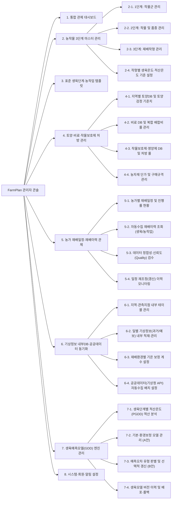

| 1Depth (대메뉴) | 2Depth (중메뉴) | 3Depth (세부 기능 및 관리 항목) | 특허 및 설계도 근거 |
| :--- | :--- | :--- | :--- |
| **1. 통합 관제 대시보드** | **1-1. 종합 운영 현황판** | • 전국 농가/재배 프로젝트 현황 (작물군·작물·재배작형별 분포)<br/>• 금일 예정 주요 농작업 및 실행 확인율(%) 실시간 집계 | 도 1, 도 2 |
| | **1-2. 기상특보 및 모델 KPI** | • 이상기후(저온/고온장해) 발생 지역 현황 및 재조정 알림 발송 건수<br/>• 생육예측모델(GDD) 평균 예측오차(MAE/일수) 및 데이터 신뢰도 현황 | 특허 청구항 1, 도 1 |
| **2. 농작물 3단계 마스터 관리** | **2-1. 1단계: 작물군 관리** | • 작물군 분류 코드·명칭 관리 (식량작물, 엽채류, 과채류, 근채류, 조미채소류 등)<br/>• 사용자 앱 노출 순서, 대표 아이콘 및 활성화 상태 설정 | 사용자 요구사항(1단계) |
| | **2-2. 2단계: 작물 및 품종 관리** | • 작물군 하위 작물(감자, 배추, 마늘, 양파, 무 등) 등록·관리<br/>• 작물별 세부 품종(예: 수미, 불암3호, 남도 등) 및 숙기 구분(조생/중생/만생종) 관리 | 사용자 요구사항(2단계)<br/>특허 [0092~0093] |
| | **2-3. 3단계: 재배작형 관리** | • 작물별 재배작형(노지 봄재배, 노지 가을재배, 고랭지재배, 난지/한지 월동재배, 시설하우스 무가온/가온 등) 정의<br/>• 작형별 표준 파종/정식 가능 월(Month) 및 월동작형 여부(`is_overwintering`) 설정 | 사용자 요구사항(3단계)<br/>도 2, 특허 [0100] |
| | **2-4. 생육온도·적산온도 기준** | • `[작물군 - 작물/품종 - 재배작형]` 매핑별 온도 파라미터 설정<br/>• 기준온도($T_b$), 필요적산온도($0^\circ\text{C}$ 기준), 필요유효적산온도($T_b$ 기준)<br/>• 발아적온, 생육최적온도(`min~max`), 생육한계온도(`최저~최고`), 생육장해온도(`저온/서리/동해/고온`) 설정 | 특허 청구항 2~3,<br/>특허 [0043~0049], 도 6 |
| **3. 표준 생육단계·농작업 템플릿** | **3-1. 생육단계(Stage) 정의** | • 작형별 표준 생육단계(예: 정식 $\rightarrow$ 활착 $\rightarrow$ 결구시작 $\rightarrow$ 수확적기) 순서 및 단계별 목표 적산온도(PGDD) 설정<br/>• 사용자 실행 확인 팝업용 **‘생육단계 판단 도움말(표준 사진 및 판별 기준 텍스트)’** 등록 | 도 2(A영역), 도 3, 도 4 |
| | **3-2. 주요·세부 농작업(Work) 템플릿** | • **주요재배일정**(토양만들기, 경운·멀칭, 파종, 정식, 수확) 및 **세부재배일정**(밑거름, 웃거름, 잡초관리, 배수관리, 방제) 표준 시점 및 권장 작업범위(`tolerance ±일`) 설정 | 특허 [0058],<br/>도 1, 도 3 |
| | **3-3. 기후변화 대응 매뉴얼 관리** | • 이상기후 시점별 대책(`사전대책 / 즉시대책 / 사후대책`) × 6대 방법(`생태적/경종적, 물리적, 기계적, 화학적, 생물적, 영양불균형 개선`) 가이드 관리 | 특허 도 2, 특허 [0127] |
| **4. 토양·비료·작물보호제 처방 관리** | **4-1. 토양DB 및 검정 기준치 관리** | • 지역별 표준 토양정보 내부 테이블 관리 및 추후 공공DB(흙토람) 동기화<br/>• 작물별 토양검정 8대 항목(`pH, 유기물, 유효인산, 칼륨, 칼슘, 마그네슘, 유효규산, 전기전도도`) 적정 범위 기준치 설정 | 특허 청구항 4,<br/>특허 [0050, 0109], 도 7 |
| | **4-2. 비료 DB 및 배합비 룰 엔진** | • 유기농/일반 비료 마스터 및 영양 성분 함량(N-P-K, 칼슘, 유기물 등) 관리<br/>• 부족 영양분 다수 발생 및 단일 비료 부재 시 **복수 비료 자동 배합비 산출 규칙** 및 시뮬레이터 | 특허 청구항 5,<br/>특허 [0108, 0111] |
| | **4-3. 작물보호제·영양제 처방 룰** | • 살균제·살충제·제초제·작물영양제 마스터 (유기농자재/일반농자재 구분)<br/>• 생육단계 + 예측기후 조건(고온다습, 장마 등)별 자동 처방 시기 및 10a당 공급량(ml/g) 산출 룰 | 특허 청구항 6, 13,<br/>특허 [0054, 0063] |
| | **4-4. 농자재 상품·단가 관리** | • 처방 결과와 연동되는 시중 농자재 상품명(예: `한팜칼슘 10Kg`), 포장규격, 단가(₩) 관리 (사용자 견적 산출용) | 특허 도 7 (우측 출력화면) |
| **5. 농가 재배일정·재배이력 관제** | **5-1. 농가별 재배일정 현황** | • 농가별 생성된 재배일정(`CULT-YYYY-NNNNNN`) 목록, 현재 진행률, 재배지역·면적·환경 옵션(멀칭/관수) 조회 | 도 2, 도 3(③영역) |
| | **5-2. 자동수집 재배이력 조회** | • 사용자의 실행 확인으로 자동 생성된 **생육단계 기록(도달일)** 및 **농작업 기록(실행일, 사용 자재, 살포량)** 통합 조회 | 도 1, 도 2(B영역), 도 3 |
| | **5-3. 데이터 정합성·신뢰도 검수** | • 실제 도달/수행일(`actual_date`) vs 앱 확인일시(`confirmed_at`) 비교 조회<br/>• 품질 검증 플래그(`날짜 순서 오류`, `누락`, `범위 이탈 이상값`) 및 **신뢰도 점수(`reliability_score`, 예: 0.95)** 검수·필터링 | 도 1, 도 3(②·③·⑤영역) |
| | **5-4. 일정 재조정(갱신) 이력** | • 농가 작업 미이행/지연에 따른 수동 갱신 이력 및 이상기후 알림에 따른 자동 재조정 전·후 일정 비교 로그 | 특허 청구항 8, 10~13,<br/>도 4(특허) |
| **6. 기상정보 내부DB·공공데이터 동기화** | **6-1. 지역·관측지점 내부 테이블 관리** | • 행정구역(시/도, 시/군/구) 코드 및 기상관측지점(`station_id`, 위·경도, 해발고도, 격자 X/Y) 내부 마스터 테이블 관리 | 도 4(② S410) |
| | **6-2. 일별 기상정보 내부 적재·관리** | • **초기 운영**: 내부 기상 테이블(`weather_daily_data`)에 시드 데이터 생성기, CSV/Excel 대량 업로드, 수동 입력/수정(이상기후 테스트 시뮬레이션용) 제공<br/>• 과거 일별 기온(`OBSERVED`) 및 미래 예측기온(`FORECAST`: 단기/중기/장기) 통합 조회·편집 | 특허 [0052~0053],<br/>도 1, 도 4 |
| | **6-3. 재배환경별 기온 보정 설정** | • 결측치 보간 규칙(선형보간/인근지점 대체) 및 재배환경(노지, 비닐멀칭, 시설 무가온/가온, 고도차)에 따른 일평균기온 보정 계수($\pm \Delta^\circ\text{C}$) 관리 | 도 1, 도 4(② S430) |
| | **6-4. 공공DB(기상청 API) 자동수집 배치** | • **확장 운영**: 기상청 기상자료개방포털 등 외부 공공데이터 Open API 인증키 설정, 수집 스케줄러(Cron) 실행/모니터링 및 내부 테이블 자동 Upsert 파이프라인 관리 | 도 1, 도 2(C영역), 도 4(② S420) |
| **7. 생육예측모델(GDD) 엔진 관리** | **7-1. 구간별 적산온도(PGDD) 역산** | • 완료/진행 중인 재배이력의 연속된 생육단계 구간($t_s \sim t_e-1$)별 내부 기상DB 기온 매칭 및 누적 유효적산온도($GDD = \sum \max(0, T_d - T_b)$) 자동 역산 조회 | 특허 청구항 14,<br/>도 1, 도 4(③·④영역) |
| | **7-2. 생육예측모델 생성 (A안)** | • 품종별 기본 적산온도 모델 생성<br/>• 재배환경별(지역·재배작형·시설) 보정모델 및 농작업 수행시점 모델 생성·조회 | 도 1 (생육예측모델 엔진 A안),<br/>도 4(⑤영역) |
| | **7-3. 예측오차 분석·선택적 갱신 (B안)** | • 예측 도달일(예측 GDD) vs 실제 도달일(실제 GDD) 오차 분석 차트<br/>• 오차 원인 판별(`품종 오차 / 환경 오차 / 기록 오차`) 후 보정대상 선택 및 후보 모델(Candidate) 시뮬레이션 | 도 1 (생육예측모델 엔진 B안),<br/>도 3(④영역), 도 4(⑤영역) |
| | **7-4. 모델 버전 DB 및 배포 관리** | • 검증 통과한 후보 모델의 승인·배포, 버전별 변경 이력(`v1.0 -> v1.1`) 조회 및 이상 발생 시 이전 버전 롤백(Rollback) | 도 1 (모델 버전 DB) |
| **8. 시스템·회원·알림 설정** | **8-1. 농가 회원 및 관리자 권한** | • 농가 회원/농장 필지 관리 및 관리자 역할(슈퍼관리자, 작물전문가, 데이터분석가) 권한(RBAC) 설정 | 시스템 공통 |
| | **8-2. 푸시·알림 메시지 템플릿** | • 이상기후 일정 변경 권고 알림(특허 `S220`), 예정 농작업 도래 알림, 생육단계 도달 확인 요청 알림 템플릿 및 발송 이력 관리 | 특허 청구항 1(`S220`),<br/>특허 [0068] |

### 6.2 관리자 핵심 모듈별 상세 기능 명세

#### (1) 3단계 농작물 마스터 관리 (Crop Taxonomy Manager)
- **3단 계층 트리(Tree) + 상세 폼(Form) 레이아웃**:
  - **좌측 패널**: `1단계 작물군` $\rightarrow$ `2단계 작물(품종 리스트)` $\rightarrow$ `3단계 재배작형`을 드래그 앤 드롭 및 추가/수정/비활성화할 수 있는 계층 트리 뷰.
  - **우측 상세 탭**:
    1. **기본/온도 파라미터 설정**: 기준온도($T_b$), 필요적산온도($0^\circ\text{C}$ 기준), 필요유효적산온도($T_b$ 기준), 발아적온, 생육최적온도(`min`~`max`), 생육한계온도(`최저`~`최고`), 생육장해온도(`저온장해`, `서리`, `동해`, `고온장해`), 평균 생육일수 설정.
    2. **작형별 특수 규칙 설정**: 월동작물 저온장해 예외 허용 여부, 멀칭/터널/시설가온 시 기온 보정 계수($+\Delta^\circ\text{C}$), 조기재배 가능 여부.
    3. **생육단계 및 주요/세부 농작업 타임라인 빌더**:
       - 생육단계(예: 정식 $\rightarrow$ 활착 $\rightarrow$ 결구시작 $\rightarrow$ 수확)별 목표 GDD 비율(%) 또는 절대값($^\circ\text{C}\cdot\text{일}$), 허용 오차(`tolerance ±일`), **판단 도움말 사진 및 가이드 문구** 등록.
       - 각 생육단계에 연동되는 표준 주요농작업(토양만들기, 파종/정식, 수확) 및 세부농작업(밑거름, 웃거름, 방제, 배수관리) 매핑.

#### (2) 토양·비료·작물보호제 DB 및 처방 룰 엔진 관리 (특허 도 1, 도 3, 도 7)
- **토양 기준치 관리**: 작물·작형별 적정 토양 화학성 범위(`pH`, `유기물`, `유효인산`, `칼륨`, `칼슘`, `마그네슘`, `유효규산`, `EC`) 내부 테이블 관리 및 추후 공공데이터(농촌진흥청 토양DB) 동기화.
- **비료 DB 및 자동 배합 규칙 관리**:
  - 유기농자재 / 일반농자재 구분, 비료별 주성분(N-P-K, 칼슘, 마그네슘, 유기물 함량 비율), 포장 단위(kg), 판매 단가(원) 관리.
  - 단일 비료 부재 시 복수 비료 배합 우선순위 및 최대 배합 개수(예: 2~3종 조합) 시뮬레이터 제공.
- **작물보호제 DB 및 기후 대응 처방 관리**:
  - 기상 조건 트리거(예: 평균기온 $25^\circ\text{C}$ 이상 + 강수일수 3일 연속 $\rightarrow$ 역병/탄저병 주의)별 추천 살균제/살충제/영양제, 10a당 처방량, 안전사용기준(수확 전 일수) 및 사전/즉시/사후 대응 매뉴얼 관리.

#### (3) 재배이력 자동 수집 및 데이터 신뢰도(Quality) 관제 (도 3 구현)
- 농가 단말에서 실행 확인(`S310~S360`)을 통해 자동 적재된 재배이력 데이터를 실시간 모니터링합니다.
- **데이터 정합성 및 신뢰도 자동 검증 필터 (`S320`)**:
  - `sequence_check`: 생육단계 도달일 순서 역전 여부 (예: 결구 시작일이 활착일보다 빠른 경우 오류 플래그)
  - `date_valid`: 예정일 대비 과도한 이탈 여부 및 미래 날짜 오입력 검사
  - `missing_flag`: 필수 중간 단계 누락 여부
  - `reliability_score`: 실제 도달일(`actual_date`)과 앱 확인일시(`confirmed_at`)의 시차, 자재 입력 충실도, 기상 데이터 정합성을 종합한 신뢰도 점수(예: `0.95 정상`, `0.60 주의`, `0.30 이상값 제외`) 표시.
- 관리자는 이상값(Outlier)으로 분류된 이력을 검수하여 **생육예측모델 학습 큐(Queue) 포함/제외 여부**를 일괄 제어할 수 있습니다.

#### (4) 기상정보 내부 테이블 우선 구축 및 추후 공공DB 자동 수집 아키텍처 (도 1, 도 4 재구성)

> [!TIP]
> **기상정보(공공데이터) 2단계 구축 전략 (Adapter & Local-First Pattern)**
> 외부 기상청(기상자료개방포털) API에 직접 실시간 의존할 경우 발생하는 응답 지연·호출 제한·테스트 제약을 방지하고, 초기 플랫폼 개발 속도를 높이기 위해 **내부 기상정보 전용 테이블을 먼저 생성하여 모든 비즈니스 로직(일정 수립 `S100`, 일정 재조정 `S200`, 적산온도 역산 `S400`)이 내부 DB만 바라보도록 분리 설계**합니다.

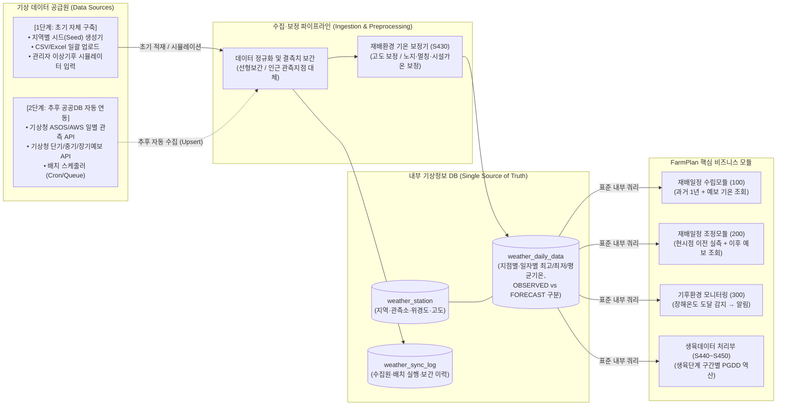

- **1단계 (내부 테이블 구축 및 자체 데이터 운영)**:
  - `weather_station`(지역·관측지점 마스터) 및 `weather_daily_data`(일별 기상 데이터) 테이블을 내부 DB에 생성합니다.
  - 관리자 페이지에서 **지역별 평년 기온 기반 시드(Seed) 데이터 자동 생성**, **CSV/Excel 업로드**, 그리고 **이상기후(한파·폭염) 테스트용 기온 수동 조작 기능**을 제공하여 외부 API 연동 없이도 초기 일정 산출, 이상기후 알림(`S220`), 하이브리드 일정 재조정(`S230`), 구간별 PGDD 역산(`S450`) 전 과정을 100% 검증·운영합니다.
- **2단계 (추후 공공DB 자동 수집 워커 연동)**:
  - 핵심 일정·모델 엔진 코드의 변경 없이, 백그라운드 배치 워커(`WeatherPublicDbSyncWorker`)만 활성화하여 기상청 기상자료개방포털 Open API로부터 매일 자정(전일 확정 관측기온 `OBSERVED` 업데이트) 및 매 6시간(단기/중기/장기 예측기온 `FORECAST` 업데이트) 주기로 데이터를 가져와 `weather_daily_data` 테이블에 자동 Upsert합니다.

#### (5) 생육예측모델 엔진 관제 (A안 & B안 워크벤치)
- **A안 (기본/보정 모델 관리)**: 품종별 기본 적산온도 모델, 지역·재배작형별 환경 보정모델, 농작업 수행시점 모델 현황 조회.
- **B안 (예측오차 분석 및 선택적 갱신 승인)**:
  1. **오차 유형 자동 판별 대시보드**: 예측 GDD vs 실제 역산 GDD의 오차(MAE, RMSE)를 분석하여 `품종 기본값 오차`, `지역/작형 환경보정 오차`, `단순 기록 오차`로 분류 시각화.
  2. **후보 모델 시뮬레이션 및 버전 배포**: 오차가 임계치를 초과한 `[작물-품종-재배작형]`에 대해 자동 생성된 **후보 모델(Candidate Model v1.x)**의 기존 대비 예측 정확도 개선율을 비교하고, 관리자 승인 시 **모델 버전 DB**에 정식 배포(또는 이전 버전 롤백)합니다.

---

## 7. 핵심 데이터베이스 스키마 (ERD & 테이블 명세)

특허명세서의 6대 DB(작물DB, 기후DB, 토양DB, 비료DB, 작물보호제DB, 일정저장DB)와 첨부 도면의 4대 DB(재배이력DB, 기상정보DB, 생육모델DB, 모델버전DB)를 통합하고 **3단계 농작물 계층**을 반영한 핵심 스키마입니다.

### 7.1 통합 ERD (Entity-Relationship Diagram)

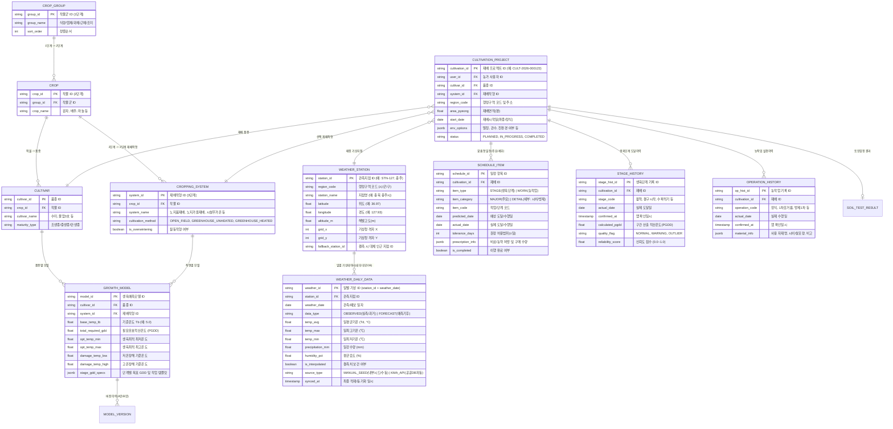

### 7.2 내부 기상정보 테이블 상세 설계 및 추후 공공DB 동기화 규격

> [!IMPORTANT]
> **초기 내부 테이블 우선 구축 및 추후 공공데이터(Open API) 자동 수집 설계 원칙**
> 1. **내부 테이블 독립 운영 (Phase 1~2)**: 개발 초기에는 외부 공공데이터 API 호출 없이도 전 기능을 즉시 구현·검증할 수 있도록 `weather_station`, `weather_daily_data`, `weather_env_correction`, `weather_sync_log` 4개 내부 테이블을 먼저 생성하고, **시드 생성 스크립트(최근 2년 과거기온 + 향후 1년 예측기온 자동 생성)** 및 **관리자 수동/CSV 적재 기능**으로 데이터를 채웁니다.
> 2. **공공DB 자동 수집 워커 확장 (Phase 3)**: 추후 기상청 기상자료개방포털(ASOS/AWS 일자료, 단기/중기/장기기온예보 API) 연동 시, 기존 비즈니스 모듈(`100`, `200`, `300`, `S410~S450`)의 쿼리 수정 없이 수집 어댑터가 `weather_daily_data` 테이블에 `source_type = 'KMA_API'`로 Upsert(`station_id + weather_date` 기준)하도록 설계합니다.

| 내부 테이블명 | 주요 컬럼 구성 | 초기 구축(내부 임의/시드 데이터) 역할 | 추후 공공DB 자동 수집(Open API) 연동 로직 |
| :--- | :--- | :--- | :--- |
| **`weather_station`**<br/>(지역·관측지점 마스터) | `station_id`(PK), `region_code`, `station_name`, `latitude`, `longitude`, `altitude_m`, `grid_x`, `grid_y`, `fallback_station_id` | • 주요 주산지(예: 충북 충주시 `127.93E, 36.97N`, 강원 평창, 전남 해남 등) 관측지점 초기 마스터 데이터 등록<br/>• 재배지 주소 입력 시 위경도 유클리드/하버사인 거리 기반 최단거리 지점 자동 매칭(`S410`) | • 기상청 관측소 메타데이터 API와 동기화하여 신규 지점 및 격자(X, Y) 좌표 자동 갱신 |
| **`weather_daily_data`**<br/>(일별 기온·기상 통합 테이블) | `weather_id`(PK), `station_id`(FK), `weather_date`, `data_type`(`OBSERVED` / `FORECAST`), `temp_avg`, `temp_max`, `temp_min`, `precipitation_mm`, `is_interpolated`, `source_type` | • `source_type = 'MANUAL_SEED'`로 과거 1년 실측기온(`OBSERVED`) 및 향후 1년 예측기온(`FORECAST`) 시드 데이터 적재<br/>• 관리자 화면에서 특정 일자 기온을 한파($\le 0^\circ\text{C}$)나 폭염($\ge 32^\circ\text{C}$)으로 변경하여 이상기후 알림(`S220`) 및 일정 재조정(`S230`) 즉시 테스트 | • **일 배치(01:00)**: 전일 기상청 ASOS/AWS 확정 기온을 가져와 `FORECAST` $\rightarrow$ `OBSERVED`로 상태 전환 및 실제 기온 덮어쓰기(특허 청구항 10 구현)<br/>• **주기 배치(6시간)**: 기상청 단기·중기·장기예보를 조회하여 오늘 이후 구간의 `FORECAST` 기온 자동 업데이트 |
| **`weather_env_correction`**<br/>(재배환경 기온 보정 테이블) | `correction_id`(PK), `cultivation_method`(`OPEN_FIELD`, `GREENHOUSE_UNHEATED`, `GREENHOUSE_HEATED`), `mulching_yn`, `altitude_diff_per_100m`, `temp_offset_c` | • 노지재배($0.0^\circ\text{C}$), 비닐멀칭($+1.5^\circ\text{C}$), 무가온하우스($+3.5^\circ\text{C}$), 가온하우스(최저기온 보장), 해발고도 $100\text{m}$당 기온 감률($-0.6^\circ\text{C}$) 등 내부 보정 규칙 저장(`S430`) | • 공공DB 원시 기온(`temp_avg`) 조회 시 농가별 재배환경 옵션을 결합하여 보정 일평균기온($T_d'$) 자동 산출 |
| **`weather_sync_log`**<br/>(기상 수집·보간 이력 테이블) | `sync_id`(PK), `station_id`, `sync_type`(`SEED`, `CSV_UPLOAD`, `PUBLIC_API`), `target_start_date`, `target_end_date`, `interpolated_count`, `status`, `executed_at` | • 초기 시드 생성, CSV 업로드, 수동 기온 수정 내역 및 결측치 보간(`S430`) 실행 로그 기록 | • 공공데이터 포털 API 호출 응답코드, 수집 건수, 결측 발생 시 `fallback_station_id` 대체 보간 내역 자동 로깅 |

### 7.3 주요 데이터 구조 및 처리 규칙 요약표 (도 3의 ⑤ 영역 및 기상 내부DB 반영)

| 데이터 유형 | 테이블명 | 주요 필수 필드 | 핵심 처리 및 검증 규칙 |
| :--- | :--- | :--- | :--- |
| **3단계 작물 마스터** | `crop_group`<br/>`crop` / `cultivar`<br/>`cropping_system` | `group_id`, `crop_id`, `cultivar_id`, `system_id`, `cultivation_method`, `is_overwintering` | • 모든 재배일정 요청 및 생육모델 조회 시 3단계 키(`group_id` $\rightarrow$ `crop_id`/`cultivar_id` $\rightarrow$ `system_id`)를 기준으로 템플릿 및 온도 파라미터 바인딩 |
| **내부 기상정보** | `weather_station`<br/>`weather_daily_data` | `station_id`, `weather_date`, `data_type`(`OBSERVED`/`FORECAST`), `temp_avg`, `temp_max`, `temp_min`, `source_type` | • 초기에는 내부 시드/수동 데이터(`MANUAL_SEED`)로 동작하며, 추후 공공DB 배치 워커가 동일 테이블에 `KMA_API` 데이터를 Upsert하여 비즈니스 로직 수정 없이 자동 전환 |
| **일정 항목** | `schedule_item` | `schedule_id`, `cultivation_id`, `item_type`(`STAGE`/`WORK`), `predicted_date`, `tolerance(±일)`, `prescription_info` | • 주요재배일정(토양만들기, 파종/정식, 수확)과 세부재배일정(비료시비, 작물보호제, 배수/잡초관리) 구분 저장<br/>• 일정 재조정 시 `is_completed = true`인 작업은 고정 후 미이행 작업만 재산출 |
| **생육단계 기록** | `stage_history` | `cultivation_id`, `stage_code`, `actual_date`, `confirmed_at`, `calculated_pgdd`, `quality_flag` | • 연속된 두 생육단계의 `actual_date` 구간($t_s \sim t_e-1$)에 대해 내부 `weather_daily_data`의 일별 기온을 매칭하여 구간 PGDD 자동 산출 및 저장 |
| **농작업 기록** | `operation_history` | `cultivation_id`, `operation_code`, `actual_date`, `confirmed_at`, `material_info` | • 농작업 완료 체크 시 처방 자재 또는 실제 투입한 비료/농약 내역을 함께 기록하여 추후 시비·방제 효과 분석에 활용 |
| **기록 품질 메타** | `record_quality_log` | `sequence_check`, `date_valid`, `missing_flag`, `reliability_score` | • `actual_date`(실제 발생일)와 `confirmed_at`(앱 입력일시)을 분리 저장하여 사후 일괄 입력 여부를 판별하고, 신뢰도 점수 산출 후 모델 학습(B안) 반영 여부 결정 |

---

## 8. 단계별 개발 로드맵 및 체크리스트

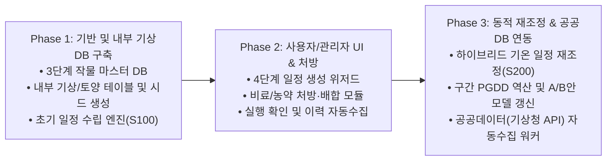

1. **Phase 1 (코어 엔진 및 3단계 작물 마스터 · 내부 기상/토양 테이블 구축)**:
   - `1단계 작물군 - 2단계 작물/품종 - 3단계 재배작형` DB 테이블 구축 및 초기 시드 데이터(감자, 배추, 마늘, 양파, 무 등) 적재.
   - 외부 공공DB 연동 전 자체적으로 동작할 수 있도록 **내부 기상정보 테이블(`weather_station`, `weather_daily_data`, `weather_env_correction`)을 생성**하고, 주산지별 과거 기온(`OBSERVED`) 및 예측 기온(`FORECAST`) 시드 생성기·관리자 편집 기능 구현.
   - 내부 기상 테이블을 조회하여 적산온도(GDD/PGDD) 기반 최적 재배기간을 탐색하는 초기 일정 수립 엔진(`S100`) 구현.
2. **Phase 2 (사용자 웹/앱 UI · 관리자 콘솔 및 비료·작물보호제 처방 연동)**:
   - 모바일 반응형 4단계 재배 시작 위저드 및 일정표/캘린더/생육가이드 UI 구현.
   - 토양검정 결과 기반 비료 배합비 산출 모듈(500) 및 예측기후 기반 작물보호제 처방 모듈(400), 농자재 구매 견적 리스트 구현.
   - 농작업 완료 / 생육단계 도달 확인 팝업 및 재배이력 자동 생성 파이프라인(`S310~S360`) 구축.
3. **Phase 3 (동적 일정 재조정 · A/B안 모델 고도화 및 공공DB 자동수집 워커 연결)**:
   - 내부 기상 테이블의 이상기후 감지(`300`) 및 [과거 실측기온(`OBSERVED`) + 미래 예측기온(`FORECAST`)] 하이브리드 일정 재조정 모듈(`200`) 구현.
   - 관리자 페이지 내 생육단계별 PGDD 자동 역산(`S410~S450`), 예측오차 유형 판별, 선택적 모델 갱신(B안) 및 버전 관리 대시보드 완성.
   - **기상청(기상자료개방포털) 및 농촌진흥청(흙토람) 공공데이터 Open API 자동 수집 배치 워커(`WeatherPublicDbSyncWorker`)**를 연결하여 내부 기상/토양 테이블에 주기적으로 데이터를 자동 적재(Upsert)하도록 확장.

